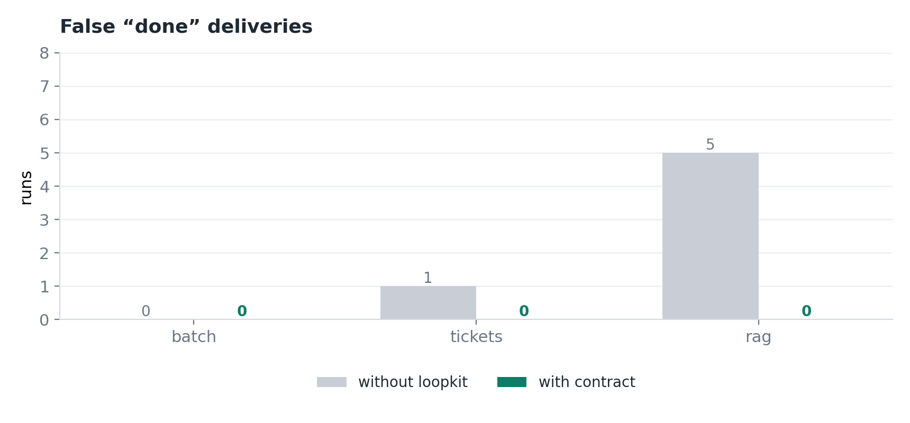
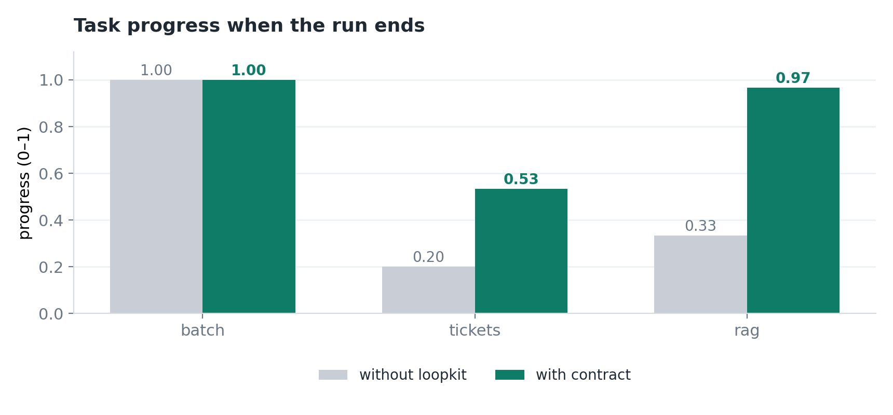

# looprise

**完成率 33% → 60%，假完成 6 次 → 0 次。**

同一模型、同一批任务、同一套工具，唯一差别是加了一份“完成”检查。

30 次 A/B（本地 7B 模型）：

| | 不用 | 用了 |
|---|---|---|
| 真正完成 | 5/15（33%） | **9/15（60%）** |
| 没做完却报“完成” | 6 次 | **0 次** |
| rag 任务完成率 | 0/5 | **4/5** |

它解决的问题很具体：**模型说“做完了”，但它没做完。**

- `max_iterations` / `recursion_limit` 只管**步数**，不知道活干完没有；
- Langfuse 之类只负责**看见**，不拦；
- LoopGain 那类收敛检测需要**可测量的 error signal**，而工具型循环（读文件、改工单）根本没有。

looprise 只做一件事：**用 10 行把“完成”写成条件，然后在每次工具调用和结束点检查它。**

> 仓库叫 looprise，Python 包名仍是 `loopkit`（PyPI 上 `loopkit` 已被占用，发布时改名）。

```python
from loopkit import Contract, ContractMonitor

contract = Contract(
    name="resolve tickets",
    done_when=lambda w: all(v == "resolved" for v in w.tickets.values()),
    advances=lambda w: sum(v == "resolved" for v in w.tickets.values()) / 6,
)
mon = ContractMonitor(contract, stall_steps=4)

while True:
    call = model.next(...)
    result = box.call(call.name, call.args)
    mon.observe(world)                  # 进度 4 步不涨 → drift
    mon.before_call(call.name, call.args, world)   # 违反 never → churn

    if call.name == "finish":
        if mon.before_stop(world):      # 没做完就想结束 → premature_stop
            continue                    # 不许交卷
        break
```

## 效果：同一模型，跑两遍

30 次运行（3 个任务 × 5 seeds × 2 条件），唯一差别是有没有契约：

| 任务 | 不用 loopkit | 用契约 |
|---|---|---|
| batch（摘要 6 篇） | 5/5 完成 · 0 假完成 | 5/5 完成 · 0 假完成 |
| tickets（结 6 单） | 0/5 完成 · 1 假完成 · 进度 0.20 | 0/5 完成 · 0 假完成 · 进度 0.53 |
| rag（答 6 题） | **0/5 完成 · 5 假完成** | **4/5 完成 · 0 假完成** |
| **合计** | **5/15 完成 · 6 次假完成** | **9/15 完成 · 0 次假完成** |





诚实的部分：

- tickets 契约也没让它做完（7B 的能力上限），但把假完成清零、进度从 0.20 拉到 0.53；
- rag 的调用从 3.4 涨到 11——因为它终于真的去做了。**这里的目标是"别交半成品"，不是"省调用"。**

### 另一个角度：三个检测器，24 条轨迹

| 检测方式 | 抓到失败 | 误报 |
|---|---:|---:|
| 看“世界有没有变化” | 0/16 | 0 |
| 看“进度是否停滞” | 8/16 | 0 |
| **契约（done_when + advances）** | **16/16** | **0** |


真实失败长这样，不是“卡死”：

| 负载 | 结局 | 模型在干什么 |
|---|---|---|
| batch | 8/8 完成 | 逐篇读、逐篇写摘要 |
| tickets | 8/8 漂移 | `get → set(in_progress) → append("Working on it.")`，从不结单 |
| rag | 8/8 早停 | 答到 0.17–0.83 就宣布 DONE |

## 为什么是你需要的

不是“又一个 agent 框架”，也不是“又一个看板”：

- **不改你的循环**：包住工具调用和结束点，三行；
- **不需要 error signal**：判据是任务状态，不是 loss；
- **确定性**：不调模型、不猜阈值，同样的轨迹永远同样的结论。

适合：把 agent 放进生产、被“假完成”坑过、又没有 verifier 的团队。

## 怎么用

```powershell
git clone https://github.com/Yunzenn/looprise.git
cd looprise
$env:PYTHONPATH="loopkit"

python -m unittest discover -s loopkit/tests -t loopkit   # 39 tests
python experiments/stasis/contract_eval.py experiments/stasis/model_traces.json   # 复现 16/16
```

实验代码与轨迹在 [`experiments/stasis/`](experiments/stasis/)，定位与非目标在 [`docs/POSITIONING.md`](docs/POSITIONING.md)。

## 边界

- 契约要你自己写——**这正是产品的重点**：把“完成”定义清楚，本来就是设计工作；
- 目前只在 3 类工具任务、24 条轨迹上验证；没有 verifier 的业务（客服、数据清洗）还需要更多验证；
- Python，未上 PyPI；`loopkit` 这个名字在 PyPI 被占用，发布时会改名。

MIT License.

---

# English

**Completion 33% → 60%. False “done” 6 → 0.**

Same model, same tasks, same tools — the only difference is one completion check.

30 A/B runs (local 7B model):

| | without | with |
|---|---|---|
| Actually completed | 5/15 (33%) | **9/15 (60%)** |
| Claimed done while incomplete | 6 | **0** |
| rag completion | 0/5 | **4/5** |

`max_iterations` counts steps, not completion. Langfuse shows you the problem but cannot stop it. LoopGain-style convergence checks need a measurable error signal — tool loops (read a file, update a ticket) have none.

looprise does one thing: **write “done” as a condition, then check it at every tool call and at the end.**

> Repo is `looprise`; the Python package is still `loopkit` (`loopkit` is taken on PyPI).

```python
from loopkit import Contract, ContractMonitor

contract = Contract(
    name="resolve tickets",
    done_when=lambda w: all(v == "resolved" for v in w.tickets.values()),
    advances=lambda w: sum(v == "resolved" for v in w.tickets.values()) / 6,
)
mon = ContractMonitor(contract, stall_steps=4)
```

## Result: same model, run twice

30 runs (3 tasks × 5 seeds × 2 conditions). The only difference is the contract:

| Task | Without loopkit | With the contract |
|---|---|---|
| batch (summarise 6 docs) | 5/5 correct · 0 false done | 5/5 correct · 0 false done |
| tickets (resolve 6) | 0/5 correct · 1 false done · progress 0.20 | 0/5 correct · 0 false done · progress 0.53 |
| rag (answer 6) | **0/5 correct · 5 false done** | **4/5 correct · 0 false done** |
| **Total** | **5/15 correct · 6 false done** | **9/15 correct · 0 false done** |

Honest notes: on `tickets` the contract still cannot make a 7B model finish, but it removes the false
“done” and raises progress from 0.20 to 0.53; on `rag` calls go from 3.4 to 11 — because the model finally
does the work. **The goal is “no half-finished deliveries”, not “fewer calls”.**

Real failures are not freezes: tickets drift (always `in_progress`, never resolved), rag stops at 17–83% and calls it done.

## Why it is different

- **No new framework**: wrap your tool call and your exit point — three lines.
- **No error signal needed**: the judge is task state, not a loss.
- **Deterministic**: no model calls, no thresholds — the same trace always yields the same verdict.

## Use it

```powershell
git clone https://github.com/Yunzenn/looprise.git
cd looprise && $env:PYTHONPATH="loopkit"
python -m unittest discover -s loopkit/tests -t loopkit
python experiments/stasis/contract_eval.py experiments/stasis/model_traces.json
```

MIT License.


