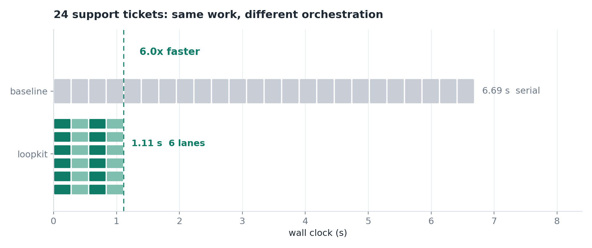
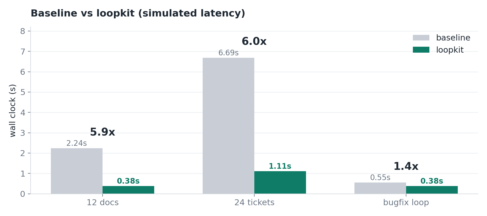
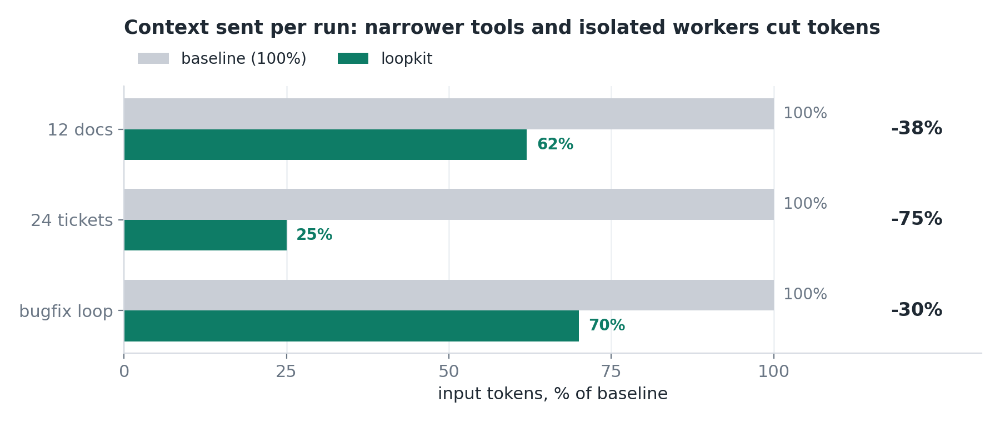

# Harness Lab

**按业务场景选工作流，并把 agent 跑得更快。**
*Pick the right workflow for a business scenario — and make the agent run faster.*

[中文](#中文) · [English](#english)


---

<a id="中文"></a>
## 中文



> 同样的 24 个工单，同样的工具调用：串行 **6.69s**，6 路并发 **1.11s**。
> 差别只在编排，不在模型。

### 效果

| | 数字 | 说明 |
|---|---|---|
| **编排加速** | **6.0x** | 24 工单 / 6 路并发（12 docs 5.9x，修 bug 循环 1.4x） |
| **上下文省** | **−75%** | 工具面从 12 个收窄到 3 个，每步固定开销直接砍掉 |
| **可测** | 20 + 8 tests | Python 20 项不变量测试，插件 8 项规则测试 |





*模拟 80ms/次模型、50ms/次工具；测的是**编排开销**，不是模型能力。*

### 30 秒上手

```powershell
git clone https://github.com/Yunzenn/harness-lab.git
cd harness-lab
$env:PYTHONPATH="loopkit"

# 1) 描述业务 -> 拓扑 + 预算 + 闸门 + 理由
python -m loopkit advise --goal "refund duplicate charges" --oracle rubric `
    --blast irreversible --heterogeneity many

# 2) 同一 kernel 跑四种控制流
python -m loopkit demo

# 3) 基线 vs 优化
python -m loopkit bench

# 4) 测试
cd loopkit; python -m unittest discover -s tests -t .
cd ../dsh-plugin; node --test
```

`advise` 输出的是可评审的计划，不是一句「建议用 ReAct」：

```
计划：L2 / route
  拓扑    L2 / route
  并发    4
  工具面  narrow-per-lane
  闸门    approval: 每个不可逆动作（代码路径，非提示）; human: 产出必须经人确认才算完成
  预算    max_steps=6, max_tool_calls=16, max_tokens_in=400000, max_seconds=60.0
  模型分层  router->small, exec->large
理由：…（每条决策一行，可被反驳）
```

### 三块内容

| 部分 | 是什么 | 形态 |
|---|---|---|
| **研究笔记** `01`–`05` | Codex / Claude Code / DSH 的 harness 拆解；业务 → 工作流选型；工具/技能/MCP/子代理；失败与放权 | 5 篇长文 |
| **`loopkit/`** | 把结论写成代码：advisor 选拓扑 + 并行/缓存/去重/模型分层 | Python，纯标准库，20 测试 |
| **`dsh-plugin/`** | 把 advisor 装进 DSH：会话里直接问「这任务该怎么编排」 | ESM 插件，8 测试 |

### 五条结论

1. **选工作流的主轴是「判据密度」，不是任务难度。** 有测试/编译器/schema，循环可以又笨又自由；判据只在人心里，循环就不该闭合在模型上。
2. **`final` 不等于成功。** 模型说「做完了」只是文本；拿它当停止条件，等于让考生自己判卷。
3. **成本的主变量是步数 × 每步固定开销。** 工具越多每一步都越贵；扇出买的是峰值上下文，不省总账。
4. **工具、技能、MCP、子代理是四个轴，不是竞品。** 能力 / 判断 / 供应链 / 上下文隔离。
5. **失败主要是设计问题。** 症状在循环层，根因通常在接口层——先改工具和契约，别先改提示词。

### 仓库结构

```
.
├── 01-loop-kernel.md            循环内核：9 个问题、8 条不变量、成本模型、停止条件、失败收尾
├── 02-scenario-to-workflow.md   五判据 → L0–L7 阶梯 → 10 模式卡 → 8 场景蓝图
├── 03-tools-skills-mcp.md       四种扩展面、工具经济学、MCP 信任红线、子代理契约
├── 04-failure-and-eval.md       MAST 失败分类、三层评估、四本预算、四级放权
├── 05-sources.md                一手资料库（DSH 插件 / 官方文档 / 论文）
├── docs/                        对比图与生成脚本（make_charts.py）
├── loop_lab/                    早期原型：一个 kernel，五个业务场景
├── loopkit/                     工具：advisor + kernel + patterns + 加速层
└── dsh-plugin/                  DSH 插件：advise_workflow（advisor 的 JS 移植）
```

### 七条不变量

1. 日志是唯一真相（可回放）。
2. 每个工具调用恰好一个结果（失败也是结果）。
3. 停止条件在模型之外。
4. 四本预算独立：步数 / 工具调用 / token / 墙钟。
5. 拒绝是代码路径，不是提示词建议。
6. 工具 schema 即提示词。
7. 不可逆动作是屏障：串行、不缓存、需审批。

### 局限

- 延迟是模拟的；真实模型长尾会让加速比下降。
- 线程不是 asyncio；没有压缩与持久缓存。
- advisor 阈值是经验值，需要用真实轨迹校准。
- 插件只做建议，不执行工作流。

### 许可

代码 MIT；研究笔记 CC BY 4.0。

---

<a id="english"></a>
## English


> Same 24 tickets, same tool calls: **6.69 s** serial, **1.11 s** across 6 lanes.
> The difference is orchestration, not the model.

### Results

| | Number | What it means |
|---|---|---|
| **Orchestration speedup** | **6.0x** | 24 tickets on 6 lanes (5.9x on 12 docs, 1.4x on a bugfix loop) |
| **Context saved** | **−75%** | Tool surface narrowed from 12 to 3, cutting fixed per-step overhead |
| **Tested** | 20 + 8 tests | 20 Python invariant tests, 8 plugin rule tests |


*Simulated 80 ms per model call, 50 ms per tool call; this measures **orchestration overhead**, not model quality.*

### Quickstart

```powershell
git clone https://github.com/Yunzenn/harness-lab.git
cd harness-lab
$env:PYTHONPATH="loopkit"

python -m loopkit advise --goal "refund duplicate charges" --oracle rubric --blast irreversible --heterogeneity many
python -m loopkit demo
python -m loopkit bench

cd loopkit; python -m unittest discover -s tests -t .
cd ../dsh-plugin; node --test
```

`advise` returns a reviewable plan — topology, concurrency, tool surface, gates, four budgets, model tiers, and the reason for every choice.

### Three parts

| Part | What | Shape |
|---|---|---|
| **Research notes** `01`–`05` | Harness teardown (Codex / Claude Code / DSH), scenario → workflow selection, the four extension surfaces, failure and staged autonomy | 5 long-form notes |
| **`loopkit/`** | The conclusions as code: advisor + parallel/cached/deduped tool batches + model tiering | Python, stdlib only, 20 tests |
| **`dsh-plugin/`** | The advisor inside DSH: ask "how should this task be orchestrated?" in-session | ESM plugin, 8 tests |

### Five findings

1. **The axis is verification density, not task difficulty.** With tests and compilers, the loop can be dumb and free; when only a human can judge, it must not close on the model.
2. **`final` is not success.** "I'm done" is text; using it as a stop condition is letting the candidate grade their own exam.
3. **Cost is steps × fixed per-step overhead.** More tools make every step pricier; fan-out buys a lower peak context, not a lower bill.
4. **Tools, skills, MCP and subagents are four axes, not competitors.** Capability / judgement / supply chain / context isolation.
5. **Failures are design failures.** Symptoms show up in the loop; root causes live in the interface layer.

### Layout

```
.
├── 01..05-*.md                  research notes
├── docs/                        charts and the script that generates them
├── loop_lab/                    prototype: one kernel, five scenarios
├── loopkit/                     the toolkit (advisor + kernel + patterns + speedups)
└── dsh-plugin/                  DSH plugin exposing advise_workflow
```

### Seven invariants

1. The log is the only truth (and it can be replayed).
2. Every tool call gets exactly one result — failures included.
3. The stop condition lives outside the model.
4. Four independent budgets: steps / tool calls / tokens / wall clock.
5. Denial is a code path, not a prompt suggestion.
6. The tool schema is the prompt.
7. Irreversible actions are barriers: serial, uncached, approval-gated.

### Limits

- Latency is simulated; real tail latency lowers the speedups.
- Threads, not asyncio; no compaction, no persistent cache.
- Advisor thresholds are heuristics that need calibration.
- The plugin only advises; it does not execute workflows.

### License

Code: MIT. Research notes: CC BY 4.0.
