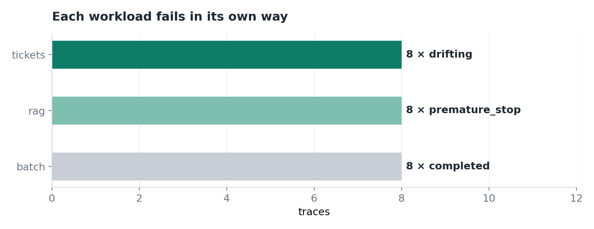
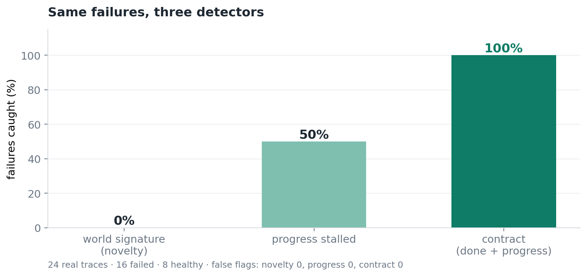
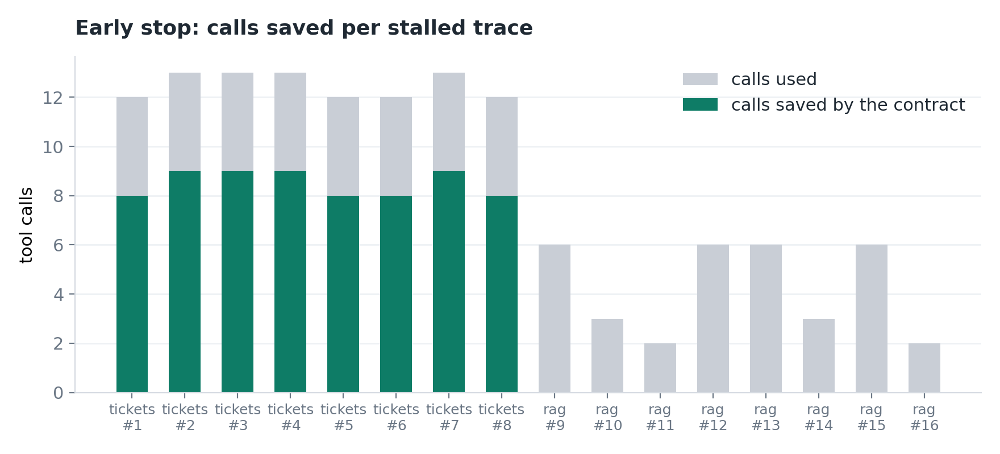

# Stasis experiment: can you detect "no progress" without a verifier?

*Can a loop tell that it is stuck when there is no error signal and no judge? Short answer: not from activity alone — you need a progress contract.*

## 问题

Reddit 研究（163k 帖）里最大的失败组是「终止与资源失败」（29%），其中「无界/空转执行」占 15.4%。
LoopGain 那类工具需要可测量的 error signal；但工具型空转（反复读同一文件、同一工单）给不出误差信号。
**能不能只看「世界有没有变化」来判断它是不是在白转？**

## 方法

两个阶段：

1. **合成场景**（`run.py`）：8 种循环形态 × 20 seeds × 4 个阈值，有精确 ground truth；
2. **真实模型**（`model_run.py`）：本地 Ollama `qwen2.5-coder:7b`，3 个工具任务 × 8 seeds = **24 条轨迹**，
   按任务级进度打标签（completed / drifting / premature_stop）。

检测器三种：

| 检测器 | 判据 | 需要什么 |
|---|---|---|
| novelty | 连续 K 步没有新的（世界指纹, 结果指纹） | 无 |
| progress | 任务进度连续 K 步不涨 | 进度函数 |
| contract | `done_when` 未达成就结束（premature）+ 进度停滞（drift） | 一份声明 |

## 结果

### 真实模型：24 条轨迹



| 结局 | 数量 | 表现 |
|---|---:|---|
| completed | 8 | batch：逐篇读、逐篇写摘要 |
| **drifting** | 8 | tickets：`get_ticket → set_ticket(in_progress) → append_answer("Working on it.")`，进度始终 0 |
| **premature_stop** | 8 | rag：答到 0.17–0.83 就宣布 DONE |

### 三个检测器



| 检测器 | 抓到 | Recall | Precision |
|---|---:|---:|---:|
| novelty | 0/16 | **0%** | — |
| progress | 8/16 | 50% | 100% |
| **contract** | **16/16** | **100%** | **100%** |

### 提前停止省下多少



| 指标 | 结果 |
|---|---|
| 失败轨迹工具调用总数 | 134 |
| 契约提前停止后省下 | **68（51%）** |
| 全部 24 条轨迹的调用节省 | 68 / 230（**30%**） |
| 误报（健康轨迹被拦） | **0** |

tickets 在第 4 次调用被判 drift，每条省 8–9 次调用；rag 在"想结束"时被判 premature_stop，省 0 次调用，
但拦住了一个进度只有 0.17 的答案——**这两类收益不该用同一个指标衡量**。

### 合成场景（早期结果）

| 场景 | 停滞检出 | 健康误报 |
|---|---:|---:|
| 反复读同一文档 / 工单 / query | 100% | 0% |
| **反复改同一篇摘要的措辞（v1→v20）** | **0%** | — |

第二行是关键：只要每步都改一点状态，novelty 检测器就认为在前进。**所以它测不了"忙而无用"。**

## 结论

1. **只看"有没有变化"的检测器，在真实模型上 0 命中。** 真实失败不是"冻结"，是"一直在动但没往前"和"没做完就说完了"。
2. **加进度函数能抓一半**；再加"结束时进度必须为 1"，16/16 全中、零误报。
3. **难点不在算法，在把"什么算完成"写下来**——也就是 `loopkit.contract` 提供的那份声明。

## 复现

```powershell
# 本地模型（本机 E:\AI\Ollama）
$env:OLLAMA_MODELS="E:\AI\Ollama\model"; & "E:\AI\Ollama\ollama.exe" serve

python experiments/stasis/model_run.py --model qwen2.5-coder:7b --per-task 8 --max-steps 12
python experiments/stasis/analyze.py experiments/stasis/model_traces.json
python experiments/stasis/contract_eval.py model_traces.json
python experiments/stasis/make_charts.py model_traces.json
```

### 关于 14B

`deepseek-r1:14b` 在本机（RTX 4060 Laptop，8GB）需要部分 offload 到 CPU，**单次调用 155 秒**，
24 条轨迹约 1.5 小时，故未纳入。7B 的结果已经稳定复现（9 条与 24 条结论一致）。
