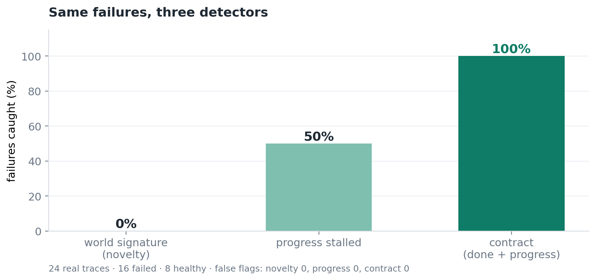

# loopkit

**让 agent 在没做完时不能交卷。**
*Stop the loop from calling it done before it is done.*

[中文](#中文) · [English](#english)

---

<a id="中文"></a>
## 中文

### 问题

24 次真实运行（本地 7B 模型，3 类工具任务）里，**16 次没有真正完成**：

- 8 次宣布 DONE 时，进度只有 0.17–0.83；
- 8 次连续十几步在“忙”，进度始终是 0（反复 `set_ticket(in_progress)`，从不结单）。

`max_iterations` 管不了这两种：它只数步数。可观测工具能看见，但不会拦。

### 做法：把“完成”写成条件

```python
from loopkit import Contract, ContractMonitor

contract = Contract(
    name="resolve tickets",
    done_when=lambda w: all(v == "resolved" for v in w.tickets.values()),
    advances=lambda w: sum(v == "resolved" for v in w.tickets.values()) / 6,
)
mon = ContractMonitor(contract, stall_steps=4)

mon.observe(world)                              # 4 步没进展 → drift
mon.before_stop(world)                          # 目标没达成 → premature_stop，不许结束
mon.before_call("set_ticket", args, world)      # 违反 never → churn
```

三个检查，全部确定性：不调模型、不猜阈值、同一条轨迹永远同一个结论。

### 效果（24 条真实轨迹）

| 检测方式 | 抓到失败 | 误报 |
|---|---:|---:|
| 看“世界有没有变化” | 0/16 | 0 |
| 看“进度是否停滞” | 8/16 | 0 |
| **契约（done_when + advances）** | **16/16** | **0** |



A/B（30 次运行，同一模型）：**假完成 6 → 0，真正完成 5/15 → 9/15**（rag 0/5 → 4/5）。
详见 [`experiments/stasis/`](../experiments/stasis/)。

附带收益：失败轨迹里提前停止省下 **51%** 的工具调用（全部轨迹口径 30%）。

复现：`python experiments/stasis/contract_eval.py experiments/stasis/model_traces.json`

### 另一个能力：预算与缓存

契约管“做得对不对”，`upgrade.py` 管“跑得太久、太贵”：

| 机制 | 作用 |
|---|---|
| `LoopGuard` | 步数/调用/token/墙钟四本预算、重复调用拦截、破坏性操作审批 |
| `ToolBox` | TTL 缓存、批内去重、有界并发、trace |
| `ContractMonitor` | 完成检查、进度停滞、churn 拦截 |

```python
from loopkit.upgrade import GuardConfig, LoopGuard, ToolBox

guard = LoopGuard(GuardConfig(max_steps=12, cache_ttl_s=60))
box = ToolBox({"read": read_file}, guard=guard)
```

同一段循环只换调用层：重复读省 50%，失控重试省 76%，同一调用 x10 省 70%（`bench/uplift_bench.py`）。

### 安装与测试

未发布 PyPI（`loopkit` 名字被占用，发布时改名）。直接放 `PYTHONPATH`：

```powershell
git clone https://github.com/Yunzenn/looprise.git
cd looprise && $env:PYTHONPATH="loopkit"
python -m unittest discover -s loopkit/tests -t loopkit   # 39 tests
```

### 局限

- 契约要你自己写——**这是设计工作，不是配置**；
- 只在 3 类工具任务、24 条轨迹上验证过；
- Python、线程而非 asyncio；未上 PyPI。

MIT License.

---

<a id="english"></a>
## English

### The problem

Across 24 real runs (local 7B model, three tool tasks), **16 never actually finished**:

- 8 declared DONE at 17–83% progress;
- 8 spent a dozen steps “working” with progress pinned at 0 (repeatedly setting a ticket to `in_progress`, never resolving it).

`max_iterations` cannot catch either: it counts steps. Observability shows it but does not stop it.

### The fix: write “done” as a condition

```python
from loopkit import Contract, ContractMonitor

contract = Contract(
    name="resolve tickets",
    done_when=lambda w: all(v == "resolved" for v in w.tickets.values()),
    advances=lambda w: sum(v == "resolved" for v in w.tickets.values()) / 6,
)
mon = ContractMonitor(contract, stall_steps=4)

mon.observe(world)                          # 4 flat steps -> drift
mon.before_stop(world)                      # goal unmet -> premature_stop
mon.before_call("set_ticket", args, world)  # forbidden -> churn
```

Deterministic: no model calls, no tuned thresholds, same trace → same verdict.

### Result (24 real traces)

| Check | Failures caught | False flags |
|---|---:|---:|
| “did the world change?” | 0/16 | 0 |
| “did progress stall?” | 8/16 | 0 |
| **contract (done_when + advances)** | **16/16** | **0** |

Bonus: early stop saves **51%** of tool calls inside failed runs (30% across all runs).

### Secondary: budgets and caching

| Piece | What it does |
|---|---|
| `LoopGuard` | four budgets, repeat interception, approval gates |
| `ToolBox` | TTL cache, batch de-dup, bounded concurrency, trace |
| `ContractMonitor` | completion check, drift, churn |

Same loop, only the call layer swapped: 50% fewer duplicate reads, 76% fewer runaway retries (`bench/uplift_bench.py`).

### Install

Not on PyPI yet (`loopkit` is taken). Put it on `PYTHONPATH`:

```powershell
git clone https://github.com/Yunzenn/looprise.git
cd looprise && $env:PYTHONPATH="loopkit"
python -m unittest discover -s loopkit/tests -t loopkit
```

### Limits

- You must write the contract — that is design work, not configuration;
- Validated on three tool tasks and 24 traces only;
- Python, threads rather than asyncio, not on PyPI.

MIT License.


